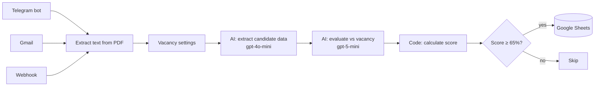

# HR Candidate Screening — n8n + AI

Automated CV screening for recruiters. Candidates send a PDF resume via **Telegram**, **email** or a **web form**. The workflow reads the resume, compares it with the vacancy requirements, calculates a match score and saves suitable candidates to **Google Sheets**.


## How it works



1. **Three input channels:** a Telegram bot, Gmail (emails with a PDF attachment) and a Webhook for website forms.
2. **Text extraction:** the PDF resume is converted to plain text.
3. **Vacancy settings:** the job title and required skills are set in one node (`Vacancy`).
4. **Data extraction (gpt-4o-mini):** AI turns the resume into structured JSON: name, contacts, experience, skills, languages, education.
5. **Evaluation (gpt-5-mini):** an AI agent acting as a technical recruiter finds which required skills the candidate has. It also writes strengths, risks, a short summary and a recommendation.
6. **Score (JavaScript):** the match score is calculated in code, not by AI.
7. **Filter:** candidates with a score of 65% or more are added to Google Sheets with the status `Новий` (New).

## Why the score is calculated in code

LLMs are not reliable at math and can give different numbers for the same resume. Here the AI only answers one question: *which required skills does the candidate have?* The Code node keeps only skills from the vacancy list and calculates:

```
score = matched skills / required skills × 100
```

The same resume always gets the same score.

With 5 required skills, each skill is worth 20%. A candidate needs at least 4 of 5 skills to pass the 65% threshold.

The AI also counts similar tools as one skill. For example, GitHub Actions or GitLab CI counts as CI/CD.

## Output

Each suitable candidate becomes one row in Google Sheets:

| Column | Description |
|---|---|
| `date` | Date and time of processing |
| `status` | Always `Новий` (New), so HR can update it later |
| `score` | Match score, 0–100 |
| `name`, `email`, `phone` | Candidate contacts |
| `vacancy` | Job title |
| `experience_years` | Years of experience |
| `matched_skills` | Required skills the candidate has |
| `missing_skills` | Required skills the candidate does not have |
| `strengths`, `risks` | Short points from the AI evaluation |
| `summary` | 2–3 sentences about the candidate for this vacancy |
| `recommendation` | For example: invite to an interview |

## Tech stack

- **n8n** (requires a recent version with AI Agent v3)
- **OpenAI:** gpt-4o-mini for extraction, gpt-5-mini for evaluation
- **n8n AI nodes:** Information Extractor, AI Agent, Structured Output Parser
- **Integrations:** Telegram Bot API, Gmail, Google Sheets
- **JavaScript** in the Code node

## Setup

1. Import `hr-candidate-screening.json` into n8n (**Workflows → Import from file**).
2. Add your credentials: OpenAI, Telegram bot (token from [@BotFather](https://t.me/BotFather)), Gmail OAuth2, Google Sheets OAuth2.
3. Create a Google Sheet with a tab named `Кандидати` and these headers in the first row:
   ```
   date | status | score | name | vacancy | email | phone | experience_years | matched_skills | missing_skills | summary | strengths | risks | recommendation
   ```
4. In the `Save to Google Sheets` node, replace `YOUR_SPREADSHEET_ID` with your sheet ID. The ID is the part of the sheet URL between `/d/` and `/edit`.
5. In the `Vacancy` node, set your job title and required skills.
6. Optional: change the threshold in the `Score ≥ 65` node.
7. Activate the workflow.

> **Tip:** the Gmail trigger processes every email with a PDF attachment. Use a separate mailbox for job applications.

### Sending a CV via webhook

```bash
curl -X POST https://YOUR-N8N-DOMAIN/webhook/hr-cv \
  -F "cv=@resume.pdf"
```

The file field must be named `cv`.

## Limitations

- **PDF only.** DOCX files and scanned PDFs (images without a text layer) are not supported yet.
- **One vacancy at a time.** It is set in the `Vacancy` node.
- **Candidates below the threshold are not saved.**
- **The AI prompts are in Ukrainian,** so the evaluation texts are in Ukrainian too. To get output in another language, edit the prompts in the `Evaluate Candidate` node.

## Roadmap

- [ ] DOCX support
- [ ] Several vacancies loaded from a Google Sheet
- [ ] LinkedIn as an input source

---

Built by [Anatolii Tiasko](https://github.com/Anatolii33)
